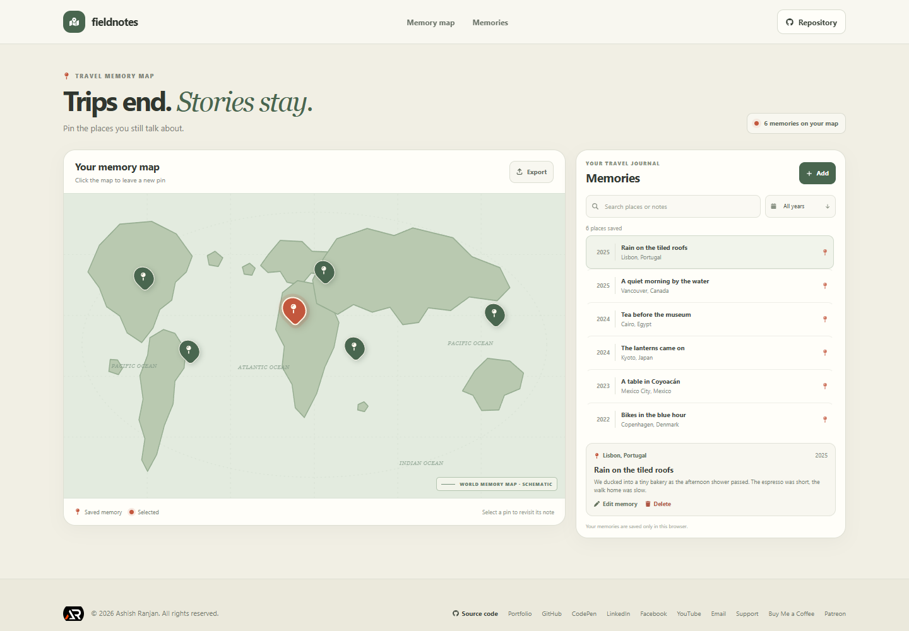

# Fieldnotes - Travel Memory Map

Fieldnotes is a personal map and journal for saving small moments from trips. Add a pin to the illustrated world map, write a note, and find it later by place or year.

**Live app:** [https://a2rp.github.io/travel-memory-map/](https://a2rp.github.io/travel-memory-map/)

## What you can do

- Browse six example memories on an illustrated, schematic world map. The map is drawn in the app and does not use map tiles or an external mapping service.
- Select a pin or journal entry to read its note.
- Click a place on the map or use **Add** to save a memory with a title, city, country, year, note, and pin position.
- Edit a memory or remove it through a confirmation dialog. Cancel or press Escape to leave it unchanged.
- Search titles, places, countries, and notes. Filter the map and journal by year.
- Export all saved memories as `fieldnotes-memories.json` for a separate backup.
- Use the app on a phone or desktop, with keyboard-accessible controls and responsive layouts.

## Saving and privacy

Memories stay in this browser's local storage on this device. The app does not create an account or send journal entries to a server. Clearing this site's browser data removes saved memories, so export a JSON backup if you need to keep them. The map is an illustration; pin coordinates are approximate and are not address lookup or navigation directions. Example memories return when there is no saved list.

## Run locally

Use Node.js and npm, then run:

```sh
npm install
npm run dev
```

Check the project and create a production build with:

```sh
npm run lint
npm run build
npm run preview
```

The production build is written to `dist`. Publish it to the configured GitHub Pages site with:

```sh
npm run deploy
```

The deploy script builds the app and publishes `dist` to the `gh-pages` branch, including the `.nojekyll` marker required for its static assets.

## Future improvements

These are ideas and are not implemented:

- Import a previously exported JSON backup.
- Let people organize memories into named trips or albums.
- Offer optional map tile layers and more precise coordinate placement.
- Add a printable journal view and filters for trips or custom tags.

## Links

- Portfolio: [https://www.ashishranjan.net](https://www.ashishranjan.net)
- GitHub: [https://github.com/a2rp](https://github.com/a2rp)
- CodePen: [https://codepen.io/ash1198](https://codepen.io/ash1198)
- LinkedIn: [https://www.linkedin.com/in/aashishranjan](https://www.linkedin.com/in/aashishranjan)
- Facebook: [https://www.facebook.com/theash.ashish/](https://www.facebook.com/theash.ashish/)
- YouTube: [https://www.youtube.com/@ashishranjan-ashz?sub_confirmation=1](https://www.youtube.com/@ashishranjan-ashz?sub_confirmation=1)
- Email: [mailto:ash.ranjan09@gmail.com](mailto:ash.ranjan09@gmail.com)

## Support

- Support: [https://a2rp-donation-page.netlify.app/](https://a2rp-donation-page.netlify.app/)
- Buy Me a Coffee: [https://buymeacoffee.com/ashishranjan](https://buymeacoffee.com/ashishranjan)
- Patreon: [https://www.patreon.com/ashishranjan](https://www.patreon.com/ashishranjan)
